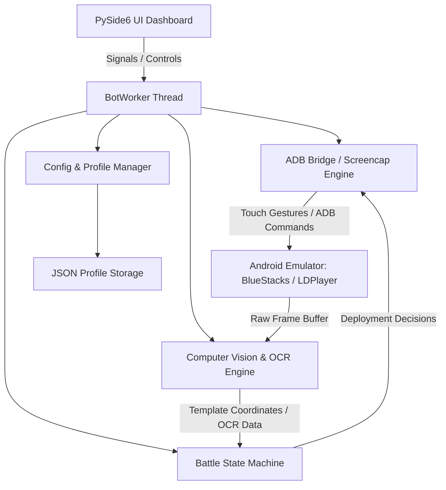

<div align="center">

# ⚔️ ClashBot-Pro

### *Next-Generation Autonomous Automation & Intelligence Suite for Clash of Clans*

[](https://www.python.org/)
[](https://www.qt.io/)
[](https://opencv.org/)
[-0078D6.svg?logo=windows&logoColor=white)](https://microsoft.com/windows)
[](https://github.com/AradhyeTushar/ClashBot-Pro/releases)
[](https://github.com/AradhyeTushar)
[](https://github.com/AradhyeTushar/ClashBot-Pro)

<p align="center">
  <b>High-performance desktop automation suite featuring OpenCV visual pattern matching, OCR resource parsing, intelligent troop deployment mechanics, Clan War coordination, Blacksmith hero equipment automation, and multi-village lifecycle management.</b>
</p>

---

</div>

## 📑 Table of Contents
- [Releases & Distributions](#-releases--distributions)
- [Overview](#-overview)
- [Key Features](#-key-features)
- [New Application Modules](#-new-application-modules)
- [System Architecture](#-system-architecture)
- [Directory Structure](#-directory-structure)
- [Prerequisites](#-prerequisites)
- [Quick Start & Execution](#-quick-start--execution)
- [Emulator Configuration](#-emulator-configuration)
- [Localization](#-localization)
- [Author & Credits](#-author--credits)
- [Disclaimer & License](#-disclaimer--license)

---

## 📦 Releases & Distributions

The `main` branch maintains a clean, lightweight, and modern codebase. Every update is officially published as a self-contained source distribution under **[GitHub Releases](https://github.com/AradhyeTushar/ClashBot-Pro/releases)** containing only the source code and necessary runtime assets (Resources, Config, Dependencies, Tools):

| Release Version | Tag / Download | Application Modules | Key Highlights | Package Content |
|---|---|---|---|---|
| **v2.1.0 (Latest)** | [**Releases / v2.1.0**](https://github.com/AradhyeTushar/ClashBot-Pro/releases/tag/v2.1.0) | **80 Modules** (+4 New) | Blacksmith Hero Equipment upgrades (BK, AQ, Minion Prince, GW, RC), Builder Hall rush engine for 6th builder, WWE event chest resolver, Ranked Battle macro, 1,026 OpenCV templates. | `ClashBot-Pro-v2.1.0-Source.zip` (Source, Resources, Config, Dependencies, Project, 1-click launcher) |
| **v1.0.0 (Base)** | [**Releases / v1.0.0**](https://github.com/AradhyeTushar/ClashBot-Pro/releases/tag/v1.0.0) | **76 Modules** | Baseline automation engine, 992 templates, 862 coordinate anchors, core multi-village loop, wall upgrade manager, Clan Games, Clan Capital, War automation. | `ClashBot-Pro-v1.0.0-Source.zip` (Source, Resources, Config, Dependencies, Project, 1-click launcher) |

> [!NOTE]
> All release packages in [Releases](https://github.com/AradhyeTushar/ClashBot-Pro/releases) include all necessary assets (`Resources/`, `Config/`, `Dependencies/Tools/`) needed to run immediately out-of-the-box via `run_bot.bat`.

---

## 🌟 Overview

**ClashBot-Pro** is a reverse-engineered, reconstructed Python 3.10 and PySide6 (Qt 6) automation architecture engineered for complete autonomous lifecycle management in *Clash of Clans*. 

The system operates externally through Android Debug Bridge (`ADB`) and screen capture technologies—ensuring native client integrity without direct in-memory manipulation. It integrates 1,026+ high-precision computer vision templates, hardware-accelerated OCR, and adaptive battle state machines to deliver an enterprise-grade automation platform.

---

## ⚡ Key Features

### 🏹 1. Intelligent Combat & Farming Engine
- **Target Filtering:** Automated multiplayer search evaluating live Gold, Elixir, Dark Elixir, and Town Hall thresholds.
- **Dynamic Deployment Algorithms:**
  - *Barch & Goblins (`barchgob.py`):* Perimeter collector farming with minimal troop expenditure.
  - *Sneaky Goblins & Sneaky Minions (`sbarb.py`, `sminion.py`):* Surgical resource sniping behind walls.
  - *Dragon & Electro Dragon Assault (`dragon.py`, `edragon.py`):* Funnel creation and chain-lightning path optimization.
  - *Valkyrie Funneling (`valkyrie.py`, `valkyrie_1side.py`):* Concentrated core penetration.
  - *Siege Machines & Throwers (`thrower.py`):* Wall-busting line deployment.
- **Smart Surrender:** Automatic battle exit upon achieving target resource collection or star objectives.

### 🏰 2. Clan Operations & War Management
- **Clan Castle Requests & Donations (`donations.py`):** Chat monitor detecting troop/spell requests with automated donation fulfillment.
- **Request & Leave (`request_and_leave.py`):** High-speed clan-hopping loop for rapid XP and badge boosting.
- **Clan Games Task Picker (`clangames.py`):** Automated challenge selection, execution, and reward claiming.
- **Clan Capital Raids (`capital_raid.py`):** Weekend raid assault participation and medal optimization.
- **Clan War Engine (`war.py`):** Strategy-based target assignment (Safe 1-Star or Optimized 3-Star attacks).

### 🛠️ 3. Village Progression & Resource Automation
- **Wall Upgrade System (`walls.py`, `auto_place_walls.py`):** Automatic excess Gold/Elixir dumping into wall levels.
- **Obstacle Clearing (`obstacle_removal.py`, `bb_obstacle_removal.py`):** Automatic gem harvesting from trees, bushes, and gem boxes.
- **Building Upgrades & Research (`upgrades_research.py`, `rush_th.py`):** Continuous laboratory research and idle builder allocation.
- **Trader & Weekly Deals (`weekly_deal.py`):** Automated trader shop reward claiming and free item redemption.

### 🌙 4. Builder Base Subsystem (`builder_base/`)
- **Clock Tower Boost:** Scheduled daily activation to accelerate production.
- **Automated Battles:** Auto-deployment of Baby Dragons/Barbs for star bonuses.
- **Gem Mine & Cart Collector:** Continuous passive resource harvesting.
- **Builder Hall Rush (`rush_bh.py`):** Automated progression strategy to fast-track unlocking B.O.B (6th builder).

### 👑 5. Hero Equipment & Blacksmith (`equipment_upgrade.py`)
- **Multi-Hero Support:** Barbarian King, Archer Queen, Minion Prince, Grand Warden, Royal Champion.
- **Ore Management:** Shiny Ore, Glowy Ore, Starry Ore allocation.
- **Dual Upgrade Modes:** Common vs. Epic equipment tier prioritization.

### 👁️ 6. Vision & Optical Intelligence
- **OpenCV Pattern Recognition (`vision.py`):** 1,026+ indexed game templates across all resolutions.
- **OCR Timer & Resource Recognition:** Tesseract-powered reading of countdown timers, shield remaining, and upgrade costs.
- **Pinch-to-Zoom Calibration (`ui2_zoom.py`):** Automatic zoom resets and anchor realignment upon village load.

---

## 💎 New Application Modules (v2.1 Update)

The latest update introduces 4 dedicated modules integrated directly into [`Source/`](file:///c:/Users/aradh/Desktop/Auto%20Clash%20clone%20Vip/Source):

1. **`equipment_upgrade.py`**: Blacksmith hero equipment auto-upgrader supporting all 5 heroes (including Supercell's new Minion Prince), utilizing multi-scale template matching and ore cost evaluation.
2. **`rush_bh.py`**: Builder Hall rushing algorithm designed to unlock the 6th builder (B.O.B) in minimum time through prioritized upgrade queues.
3. **`startup_checks.py`**: Automated startup modal and event resolver that dismisses promotional banners, claims WWE event chests, and clears return reward popups.
4. **`ranked_unlock.py`**: Macro sequence handling new account ranked battle dialogues and unlocking competitive gameplay.

For technical specifications, state machines, and implementation details, see [`docs/NEW_MODULES_SPECIFICATION.md`](file:///c:/Users/aradh/Desktop/Auto%20Clash%20clone%20Vip/docs/NEW_MODULES_SPECIFICATION.md).

---

## 🏗️ System Architecture



---

## 📁 Directory Structure

```text
ClashBot-Pro/
├── Source/                       # 80 Operational Python Modules (Full Application Engine)
│   ├── attack/                   # Combat strategies (Barch, Dragons, Valkyries, etc.)
│   ├── builder_base/             # Builder base automation & vision routines
│   ├── profiles/                 # Profile & configuration manager
│   ├── ui/                       # PySide6 graphical user interface & workers
│   ├── utils/                    # ADB multitouch, path resolver, backup utilities
│   ├── equipment_upgrade.py      # Hero equipment auto-upgrader
│   ├── rush_bh.py                # Builder Hall rush strategy
│   ├── startup_checks.py         # Event chest & modal resolver
│   ├── ranked_unlock.py          # Ranked battle unlock macro
│   └── fixed_points_source.py    # 906 decrypted screen coordinate anchors
│
├── Resources/                    # Runtime game assets & visual data
│   ├── templates/                # 1,026 OpenCV pattern matching templates
│   ├── assets/                   # UI styling, SVGs, icons, fixed_points_data.enc
│   └── locales/                  # 11 multi-language translation files
│
├── Config/                       # User profiles & application settings
│   ├── profiles/                 # Account configuration profiles
│   ├── treasureloot/             # Treasure chest loot tables
│   └── bot.config                # Primary configuration schema
│
├── Dependencies/                 # Embedded binary toolchain
│   └── Tools/                    # adb.exe, tesseract OCR engine, uiautomator2 data
│
├── Project/                      # Development & test harness
│   ├── run.py                    # Application launcher
│   ├── test_suite.py             # Automated unit tests
│   └── pyproject.toml            # Project metadata & build configuration
│
├── docs/                         # Technical documentation & recovery audits
│   ├── ANALYSIS.md               # Reverse engineering technical report
│   ├── DEPENDENCIES.md           # Dependencies & toolchain audit
│   ├── NEW_MODULES_SPECIFICATION.md # Specifications for 4 new v2.1 modules
│   ├── RECOVERY_REPORT_v1.0.md   # Base release recovery audit report
│   └── RECOVERY_REPORT_v2.1.md   # Update comparative recovery report
│
├── run_bot.bat                   # Portable 1-click launcher
├── .gitignore                    # Git ignore configuration
└── README.md                     # Master documentation
```

---

## 💻 Prerequisites

- **Operating System:** Windows 10 or Windows 11 (64-bit)
- **Python Version:** Python 3.10.x 64-bit ([Python 3.10.11](https://www.python.org/downloads/release/python-31011/) recommended)
- **Android Emulator:** 
  - [BlueStacks 5](https://www.bluestacks.com/) (Nougat 64-bit / Pie 64-bit)
  - [LDPlayer 9](https://www.ldplayer.net/)
- **ADB Debugging:** Enabled in emulator settings.

---

## 🚀 Quick Start & Execution

### Option 1: 1-Click Portable Launcher
Double-click [`run_bot.bat`](file:///c:/Users/aradh/Desktop/Auto%20Clash%20clone%20Vip/run_bot.bat) in the root directory. The launcher sets the execution environment, verifies dependencies, and starts the bot application.

### Option 2: Command Line
```cmd
cd Source
python ..\Project\run.py
```

### Option 3: Manual Virtual Environment Setup
1. **Navigate to the Project directory:**
   ```bash
   cd Project
   ```
2. **Create and activate a virtual environment:**
   ```cmd
   python -m venv venv
   venv\Scripts\activate
   ```
3. **Install dependencies:**
   ```cmd
   pip install --upgrade pip
   pip install -r requirements.txt
   ```
4. **Launch the application:**
   ```cmd
   python run.py
   ```

---

## 📱 Emulator Configuration

For pixel-perfect template matching, configure your emulator with the following settings:

| Setting | Recommended Value |
|---|---|
| **Display Resolution** | `860 x 480` or `1280 x 720` (Landscape) |
| **Pixel Density (DPI)** | `160 DPI` |
| **Graphics Engine** | DirectX or OpenGL with GPU Rendering |
| **ADB Debugging** | Enabled (Default Port: `5555` / `5556`) |

---

## 🌐 Localization

The interface supports 11 languages with hot-swapping via the GUI:

| Code | Language | Code | Language |
|:---:|:---|:---:|:---|
| `en` | English | `hi` | हिन्दी (Hindi) |
| `es` | Español (Spanish) | `fr` | Français (French) |
| `de` | Deutsch (German) | `ru` | Русский (Russian) |
| `ar` | العربية (Arabic) | `id` | Bahasa Indonesia |
| `pt-br` | Português (Brasil) | `tl` | Tagalog (Filipino) |
| `tr` | Türkçe (Turkish) | | |

---

## 👤 Author & Maintainer

Maintained and developed by:

**Aradhye Tushar**  
- **GitHub:** [@AradhyeTushar](https://github.com/AradhyeTushar)  
- **Repository:** [ClashBot-Pro](https://github.com/AradhyeTushar/ClashBot-Pro)  
- **Releases:** [ClashBot-Pro Releases](https://github.com/AradhyeTushar/ClashBot-Pro/releases)

---

## ⚖️ Disclaimer & License

> [!IMPORTANT]
> **Educational & Research Notice:** This project is intended strictly for educational, security research, and interoperability analysis purposes. Clash of Clans is a registered trademark of Supercell Oy. This project is not affiliated with, endorsed, sponsored, or specifically approved by Supercell. Users are responsible for complying with the game's Terms of Service.
