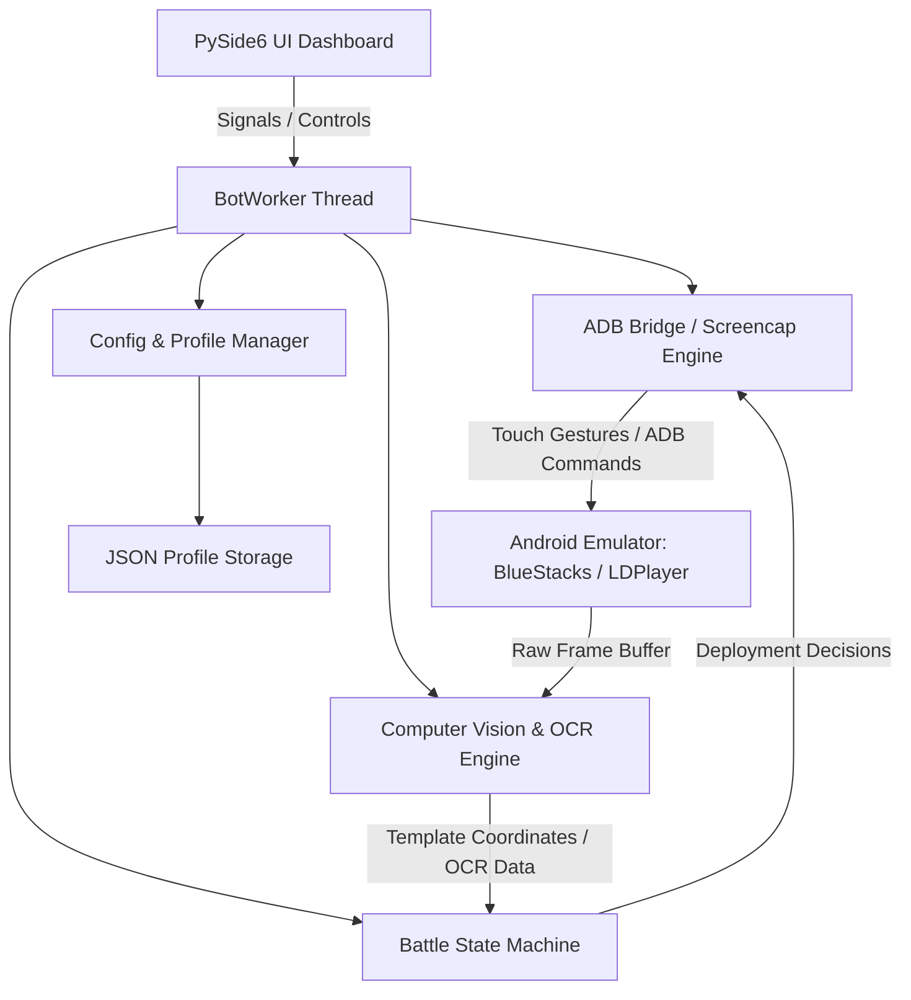

<div align="center">

# ⚔️ ClashBot-Pro

### *Next-Generation Autonomous Automation & Intelligence Suite for Clash of Clans*

[](https://www.python.org/)
[](https://www.qt.io/)
[](https://opencv.org/)
[-0078D6.svg?logo=windows&logoColor=white)](https://microsoft.com/windows)
[](https://github.com/AradhyeTushar)
[](https://github.com/AradhyeTushar/ClashBot-Pro)

<p align="center">
  <b>High-performance desktop automation suite featuring OpenCV visual pattern matching, OCR resource parsing, intelligent troop deployment mechanics, Clan War coordination, and multi-village management.</b>
</p>

---

</div>

## 📑 Table of Contents
- [Available Releases & Updates](#-available-releases--updates)
- [Overview](#-overview)
- [Key Features](#-key-features)
- [System Architecture](#-system-architecture)
- [Directory Structure](#-directory-structure)
- [Prerequisites](#-prerequisites)
- [Quick Start & Installation](#-quick-start--installation)
- [Emulator Configuration](#-emulator-configuration)
- [Configuration & Profiles](#-configuration--profiles)
- [Localization](#-localization)
- [Author & Credits](#-author--credits)
- [Disclaimer & License](#-disclaimer--license)

---

## 📦 Available Releases & Updates

| Release Version | Directory | Application Modules | New Features & Changes | Dedicated Documentation |
|---|---|---|---|---|
| **Base Release (v1.0)** | [`releases/v1.0-base/`](file:///c:/Users/aradh/Desktop/Auto%20Clash%20clone%20Vip/releases/v1.0-base/) | 76 Modules | 992 Templates, 862 Anchors, Core Automation Engine | [Base README](file:///c:/Users/aradh/Desktop/Auto%20Clash%20clone%20Vip/releases/v1.0-base/README.md) • [Report](file:///c:/Users/aradh/Desktop/Auto%20Clash%20clone%20Vip/docs/RECOVERY_REPORT_v1.0.md) |
| **New Update (v2.1)** | [`releases/v2.1-update/`](file:///c:/Users/aradh/Desktop/Auto%20Clash%20clone%20Vip/releases/v2.1-update/) | 80 Modules (+4 New) | 1,026 Templates (+35), 906 Anchors (+44), Blacksmith Hero Equipment, BH Rush, Startup Modals | [Update README](file:///c:/Users/aradh/Desktop/Auto%20Clash%20clone%20Vip/releases/v2.1-update/README.md) • [New Modules](file:///c:/Users/aradh/Desktop/Auto%20Clash%20clone%20Vip/releases/v2.1-update/New_Application_Modules/README.md) • [Report](file:///c:/Users/aradh/Desktop/Auto%20Clash%20clone%20Vip/docs/RECOVERY_REPORT_v2.1.md) |

> [!TIP]
> Each update has its own dedicated `README.md` and self-contained workspace under `releases/`. The new update also provides an isolated [`New_Application_Modules/`](file:///c:/Users/aradh/Desktop/Auto%20Clash%20clone%20Vip/releases/v2.1-update/New_Application_Modules/) folder detailing the 4 newly added modules.

---

## 🌟 Overview

**ClashBot-Pro** is a reverse-engineered, reconstructed Python 3.10 and PySide6 (Qt 6) automation architecture engineered for complete autonomous lifecycle management in *Clash of Clans*. 

The system operates externally through Android Debug Bridge (`ADB`) and screen capture technologies—ensuring native client integrity without direct in-memory manipulation. It integrates 990+ high-precision computer vision templates, hardware-accelerated OCR, and adaptive battle state machines to deliver an enterprise-grade automation platform.

---

## ⚡ Key Features

### 🏹 1. Intelligent Combat & Farming Engine
- **Target Filtering:** Automated multiplayer search evaluating live Gold, Elixir, Dark Elixir, and Town Hall thresholds.
- **Dynamic Deployment Algorithms:**
  - *Barch & Goblins (`barchgob.py`):* Perimeter collector farming with minimal troop expenditure.
  - *Sneaky Goblins & Sneaky Minions (`sbarb.py`, `sminion.py`):* Surgical resource sniping behind walls.
  - *Dragon & Electro Dragon Assault (`dragon.py`, `edragon.py`):* Funnel creation and chain-lightning path optimization.
  - *Valkyrie Funneling (`valkyrie.py`, `valkyrie_1side.py`):* Concentrated core penetration.
  - *Siege Machines & Throwers (`thrower.py`):* Wall-busting line deployment.
- **Smart Surrender:** Automatic battle exit upon achieving target resource collection or star objectives.

### 🏰 2. Clan Operations & War Management
- **Clan Castle Requests & Donations (`donations.py`):** Chat monitor detecting troop/spell requests with automated donation fulfillment.
- **Request & Leave (`request_and_leave.py`):** High-speed clan-hopping loop for rapid XP and badge boosting.
- **Clan Games Task Picker (`clangames.py`):** Automated challenge selection, execution, and reward claiming.
- **Clan Capital Raids (`capital_raid.py`):** Weekend raid assault participation and medal optimization.
- **Clan War Engine (`war.py`):** Strategy-based target assignment (Safe 1-Star or Optimized 3-Star attacks).

### 🛠️ 3. Village Progression & Resource Automation
- **Wall Upgrade System (`walls.py`, `auto_place_walls.py`):** Automatic excess Gold/Elixir dumping into wall levels.
- **Obstacle Clearing (`obstacle_removal.py`, `bb_obstacle_removal.py`):** Automatic gem harvesting from trees, bushes, and gem boxes.
- **Building Upgrades & Research (`upgrades_research.py`, `rush_th.py`):** Continuous laboratory research and idle builder allocation.
- **Trader & Weekly Deals (`weekly_deal.py`):** Automated trader shop reward claiming and free item redemption.

### 🌙 4. Builder Base Subsystem (`builder_base/`)
- **Clock Tower Boost:** Scheduled daily activation to accelerate production.
- **Automated Battles:** Auto-deployment of Baby Dragons/Barbs for star bonuses.
- **Gem Mine & Cart Collector:** Continuous passive resource harvesting.
- **Builder Hall Rush (`rush_bh.py`):** Automated B.O.B unlock path for 6th builder.

### 👑 5. Hero Equipment & Blacksmith (`equipment_upgrade.py`)
- **Multi-Hero Support:** Barbarian King, Archer Queen, Minion Prince, Grand Warden, Royal Champion.
- **Ore Management:** Shiny Ore, Glowy Ore, Starry Ore allocation.
- **Dual Upgrade Modes:** Common vs. Epic equipment tier prioritization.

### 👁️ 6. Vision & Optical Intelligence
- **OpenCV Pattern Recognition (`vision.py`):** 1,026+ indexed game templates across all resolutions.
- **OCR Timer & Resource Recognition:** Tesseract-powered reading of countdown timers, shield remaining, and upgrade costs.
- **Pinch-to-Zoom Calibration (`ui2_zoom.py`):** Automatic zoom resets and anchor realignment upon village load.

---

## 🏗️ System Architecture



---

## 📁 Directory Structure

```text
ClashBot-Pro/
├── releases/
│   ├── v1.0-base/                        # Base Release Source Code & Assets
│   │   ├── README.md                     # Dedicated v1.0 Documentation
│   │   ├── Source/                       # 76 Operational Python Modules
│   │   ├── Resources/                    # 992 Templates, Assets, 11 Locales
│   │   ├── Config/                       # bot.config, profiles, treasureloot
│   │   ├── Dependencies/                 # Tools (adb, tesseract), manifests
│   │   ├── Analysis/                     # Module hierarchy & constants dumps
│   │   ├── Metadata/                     # PE headers, section maps, sha256 hashes
│   │   └── Project/                      # run.py, test_suite.py, pyproject.toml
│   │
│   └── v2.1-update/                      # New Update Source Code & Assets
│       ├── README.md                     # Dedicated v2.1 Documentation
│       ├── New_Application_Modules/      # Showcase of 4 new modules + docs
│       │   ├── equipment_upgrade.py      # Hero equipment auto-upgrader
│       │   ├── rush_bh.py                # Builder Hall rush algorithm
│       │   ├── startup_checks.py         # Event chest & dialogue resolver
│       │   ├── ranked_unlock.py          # Ranked battle unlock macro
│       │   └── README.md                 # Deep-dive technical specifications
│       ├── Source/                       # 80 Operational Python Modules (including 4 new)
│       ├── Resources/                    # 1,026 Templates (+35 new), Assets, Locales
│       ├── Config/                       # bot.config, profiles, treasureloot
│       ├── Dependencies/                 # Tools (adb, tesseract), manifests
│       ├── Analysis/                     # Module hierarchy & constants dumps
│       ├── Metadata/                     # PE headers, section maps, sha256 hashes
│       └── Project/                      # run.py, test_suite.py, pyproject.toml
│
├── binaries/
│   └── v2.1-update/                      # Original Untouched Executables
│       └── AutoClash.exe                 # Preserved Binary (97,794,560 bytes)
│
├── docs/
│   ├── ANALYSIS.md                       # Reverse engineering technical report
│   ├── DEPENDENCIES.md                   # Dependencies and toolchain audit
│   ├── RECOVERY_REPORT_v1.0.md           # Base release recovery audit report
│   └── RECOVERY_REPORT_v2.1.md           # New update comparative recovery report
│
├── .gitignore                            # Standard Git ignore rules
├── README.md                             # Master project documentation
├── run_v1_base.bat                       # 1-Click launcher for Release v1.0
├── run_v2_update.bat                     # 1-Click launcher for Release v2.1
└── run_bot.bat                           # 1-Click launcher (defaults to latest v2.1)
```

---

## 💻 Prerequisites

- **Operating System:** Windows 10 or Windows 11 (64-bit)
- **Python Version:** Python 3.10.x 64-bit ([Python 3.10.11](https://www.python.org/downloads/release/python-31011/) recommended)
- **Android Emulator:** 
  - [BlueStacks 5](https://www.bluestacks.com/) (Nougat 64-bit / Pie 64-bit)
  - [LDPlayer 9](https://www.ldplayer.net/)
- **ADB Debugging:** Enabled in emulator settings.

---

## 🚀 Quick Start & Execution

### 1-Click Batch Launchers:
- **Latest Version (v2.1 Update):** Double-click [`run_bot.bat`](file:///c:/Users/aradh/Desktop/Auto%20Clash%20clone%20Vip/run_bot.bat) or [`run_v2_update.bat`](file:///c:/Users/aradh/Desktop/Auto%20Clash%20clone%20Vip/run_v2_update.bat).
- **Base Version (v1.0):** Double-click [`run_v1_base.bat`](file:///c:/Users/aradh/Desktop/Auto%20Clash%20clone%20Vip/run_v1_base.bat).

### Command Line Execution:
```cmd
# Run latest v2.1 update
cd releases\v2.1-update\Source
python ..\Project\run.py

# Run base v1.0 version
cd releases\v1.0-base\Source
python ..\Project\run.py
```

### Git Clone & Setup:
```bash
git clone https://github.com/AradhyeTushar/ClashBot-Pro.git
cd ClashBot-Pro
.\run_bot.bat
```
*The launcher automatically resolves all local project paths and boots the GUI.*

---

### Option 2: Manual Setup

1. **Navigate to the Project directory:**
   ```bash
   cd releases/v2.1-update/Project
   ```

2. **Create and activate a virtual environment:**
   ```cmd
   python -m venv venv
   venv\Scripts\activate
   ```

3. **Install dependencies:**
   ```cmd
   pip install --upgrade pip
   pip install -r requirements.txt
   ```

4. **Launch the application:**
   ```cmd
   python run.py
   ```

---

## 📱 Emulator Configuration

For pixel-perfect template matching, configure your emulator with the following settings:

| Setting | Recommended Value |
|---|---|
| **Display Resolution** | `860 x 480` or `1280 x 720` (Landscape) |
| **Pixel Density (DPI)** | `160 DPI` |
| **Graphics Engine** | DirectX or OpenGL with GPU Rendering |
| **ADB Debugging** | Enabled (Default Port: `5555` / `5556`) |

---

## 🌐 Localization

The interface supports 11 languages with hot-swapping via the GUI:

| Code | Language | Code | Language |
|:---:|:---|:---:|:---|
| `en` | English | `hi` | हिन्दी (Hindi) |
| `es` | Español (Spanish) | `fr` | Français (French) |
| `de` | Deutsch (German) | `ru` | Русский (Russian) |
| `ar` | العربية (Arabic) | `id` | Bahasa Indonesia |
| `pt-br` | Português (Brasil) | `tl` | Tagalog (Filipino) |
| `tr` | Türkçe (Turkish) | | |

---

## 👤 Author & Maintainer

Maintained and developed by:

**Aradhye Tushar**  
- **GitHub:** [@AradhyeTushar](https://github.com/AradhyeTushar)  
- **Repository:** [ClashBot-Pro](https://github.com/AradhyeTushar/ClashBot-Pro)

---

## ⚖️ Disclaimer & License

> [!IMPORTANT]
> **Educational & Research Notice:** This project is intended strictly for educational, security research, and interoperability analysis purposes. Clash of Clans is a registered trademark of Supercell Oy. This project is not affiliated with, endorsed, sponsored, or specifically approved by Supercell. Users are responsible for complying with the game's Terms of Service.
